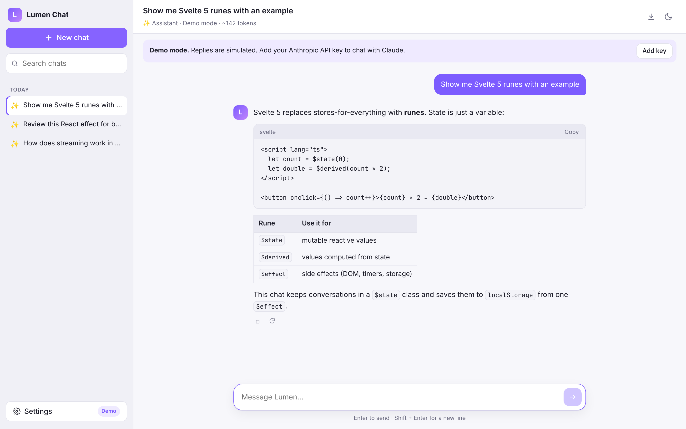
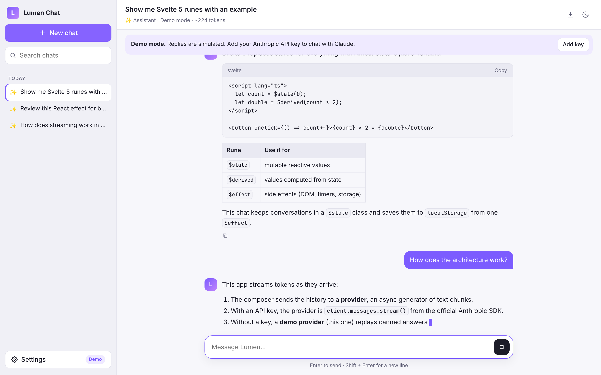
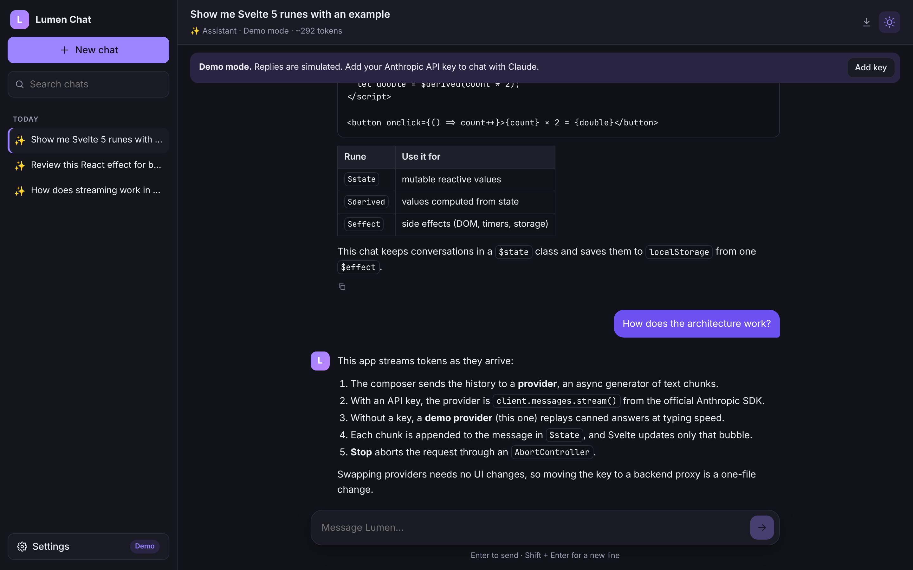
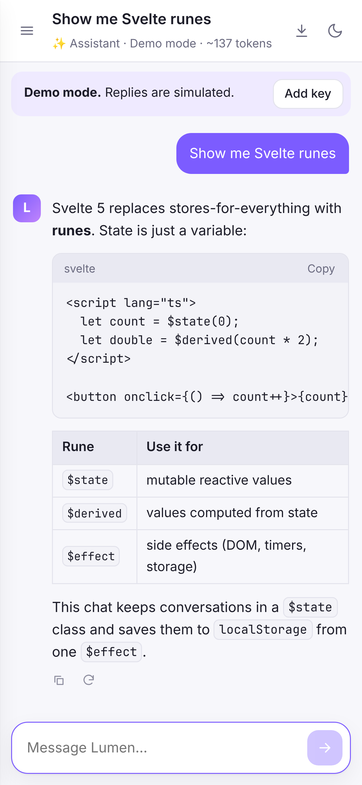

# Lumen Chat: streaming AI assistant in Svelte 5

A ChatGPT-style chat client built with **Svelte 5 (runes)**, **TypeScript** and the official
**Anthropic SDK**. Replies stream token by token, conversations persist locally, and the app works
without any key thanks to a built-in demo mode.

**Live demo:** https://dmytro-kuz.github.io/svelte-ai-chat/



## Features

- **Real streaming** from Claude via `client.messages.stream()`, with a **Stop** button (`AbortController`)
- **Demo mode** when no API key is set: canned answers streamed at typing speed, so the demo always works
- **Bring your own key**: paste an Anthropic API key in Settings and pick Opus, Sonnet or Haiku
- **Personas** (assistant, code reviewer, copywriter, translator) that switch the system prompt
- **Markdown rendering** with GFM tables, code blocks with a copy button, and **XSS-safe output** (DOMPurify)
- **Chat history** in `localStorage`, grouped by date, with search, rename (double-click) and delete
- Regenerate the last answer, copy any reply, **export a chat to Markdown**
- Friendly error messages for bad keys, rate limits and network errors
- Light and dark theme, responsive layout with a drawer sidebar on mobile, keyboard-friendly (`Enter` / `Shift+Enter`)

| Streaming | Dark theme | Mobile |
| --- | --- | --- |
|  |  |  |

## Architecture

```
src/
  App.svelte                  layout, autoscroll, theme, export
  lib/
    chat.svelte.ts            ChatStore: $state class with send / stop / regenerate
    providers/
      anthropic.ts            Claude API provider (official SDK, streaming)
      demo.ts                 offline provider that simulates streaming
    markdown.ts               marked + DOMPurify renderer
    chat-utils.ts             titles, date groups, search, export (pure functions)
    components/               Sidebar, Message, Composer, SettingsDialog, Icon
```

The UI talks to a single interface:

```ts
type ChatProvider = (req: { system; messages; signal }) => AsyncIterable<string>;
```

Both providers implement it, so the store and components do not know where the text comes from.
Moving the API key to a backend proxy (the right choice for a production app) means writing one
more provider that reads a server-sent stream; nothing else changes.

> **About the key:** in this demo the key stays in the visitor's browser and is sent only to
> `api.anthropic.com`. That is fine for a personal tool, but a public product should keep keys on a server.

## Tech stack

Svelte 5 · TypeScript · Vite · @anthropic-ai/sdk · marked · DOMPurify · Vitest · Testing Library · GitHub Actions / Pages

## Run locally

```bash
npm install
npm run dev        # http://localhost:5173
npm test           # 28 unit and component tests
npm run check      # svelte-check type checking
npm run build
```

## Tests

- `chat.test.ts`: the store streams replies, passes persona and history, records errors, keeps partial text on stop, regenerates
- `markdown.test.ts`: tables and code blocks render, scripts, event handlers and `javascript:` links are stripped
- `demo.test.ts`: chunking is lossless and the demo stream reproduces the full answer
- `chat-utils.test.ts`: titles, date grouping, search and export
- `Composer.test.ts`: Enter sends, Shift+Enter does not, Stop works while streaming

## License

MIT © Dmytro Kuz
